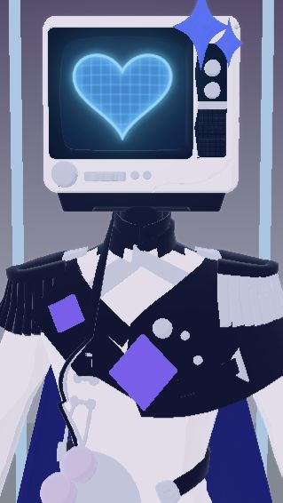
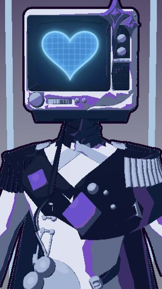
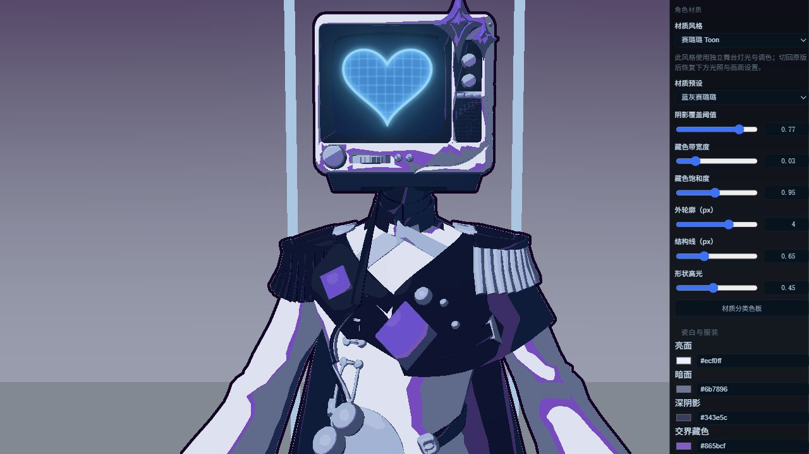

# Room TV 赛璐璐材质与本机预设（2026-10-12，partial）

入口：视频通话 → 编辑模式 → 角色材质。支持电视机 v02/v03；原版、浅色 Toon（旧版）、赛璐璐可切换。仍支持 roomToon=1，显式选择原版优先于 URL。没有保存设置且没有 URL 开关时保持原版。

本轮把默认阴影从高饱和紫色改成蓝灰。五类材质各有亮面、暗面、深阴影、明暗交界藏色和高光色，支持颜色选择器与 HEX；阴影覆盖阈值、藏色宽度/饱和度、外轮廓 CSS px、结构线 px、高光强度均可调。内置蓝灰/冷紫两款预设，可命名保存、调用、删除最多 32 个自定义预设，随本机 room.settings 保存；不向后端或手机同步。

渲染链：useRoomScene → resolveCel → RoomToonValidation.apply/render → 原有 MeshToonMaterial shader 局部 patch → 独立屏幕/装饰 bloom → 全角色 normal/depth mask 外轮廓与服装结构线 → OutputPass。原版继续走 GradeRenderer，旧版继续走 OutlinePass。每帧 finally 恢复原材质、灯光、投影与背景，屏幕 PNG 独立保留。GLB、骨骼、UV、蒙皮和动作系统无改动。

celShader.ts 用归一化 N·L 决定硬边亮/暗/深阴影，交界带围绕光照阈值生成，不是观察方向 rim。色板乘原纹理，独立金属高光由半角向量硬阈值控制；不使用写实金属反射。coverage 是受光阈值，不承诺固定像素阴影百分比，实际面积随模型法线与光向改变。背景保持渐变/少量发光面和假接触阴影，不恢复大面积实时投影。

参考选择：[MToon 规范](https://github.com/vrm-c/vrm-specification/blob/master/specification/VRMC_materials_mtoon-1.0/README.md)和 [MToonMaterial](https://pixiv.github.io/three-vrm/docs/classes/three-vrm.MToonMaterial.html)提供 shade/toony/rim/outline 思路；本轮没有完整接入 VRM/MToon。对比 [OutlineEffect](https://threejs.org/docs/pages/OutlineEffect.html) 与支持蒙皮的 inverted hull：逐网格反壳容易出现重叠关节接缝，本轮选全角色 union mask 在屏幕空间膨胀，Three 原生 MeshNormalMaterial 保留 skin/morph 支持。粗轮廓默认 4px、内部线 0.65px、深紫黑；电视机硬件/小装饰仅参与外轮廓，服装连续深度法线折面生成细线。

实际证据：同 TV v03、屏幕 normal PNG、机位与独立舞台灯光，浏览器 WebGL 静态真实渲染：

| 旧浅色 Toon | 新蓝灰赛璐璐 |
| --- | --- |
|  |  |

浏览器验证：材质/矩阵/投影/背景恢复检查 true；HEX 暗面改为 #697a93 → 命名保存 → 刷新 → 同色恢复；原版切换 effective mode=original。内置蓝灰重新应用成功。静态渲染可见衣袖大块蓝灰硬阴影、窄紫色交界与粗外线。结构线为法线折面验证实现，部分密集披风折面仍有碎线，未声称已完成所有动态姿态清理。

可用：编辑切换、分类配色、参数及本机预设；验证性质：材质分类按 TV 材质名、结构线阈值与形状高光。真实 Tauri 窗口、动态动作穿插、DPR/多 GPU 性能和发行包验收 open。无跨端影响：没有新 IPC/REST/WS，没有修改聊天或嵌入调用链；后端管理面不需要本机材质开关，手机没有消费此 Three Room 渲染器。
