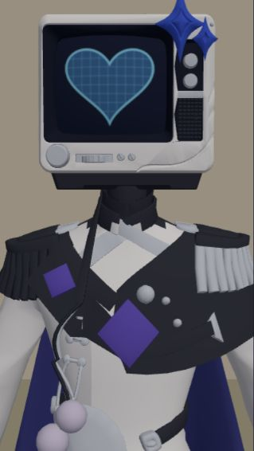
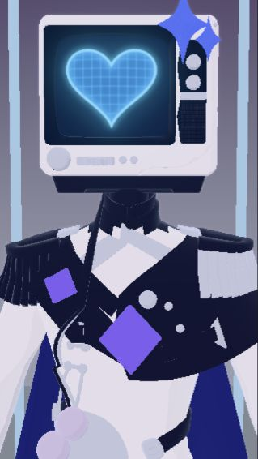
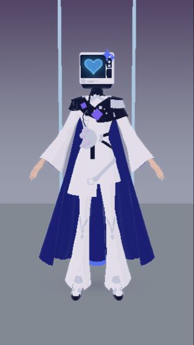

# Room 电视机三渲二验证（2026-10-11，partial）

本轮交付一版可运行的前端材质实验。只对 Room 的 TV v02/v03 启用；默认渲染不变，动作、GLB、UV、骨架、权重、Pet 和后端合同不变。工单见 `../cc-tasks/2026-10-11-room-toon-validation.md`。

## 实际对比与复现

| 原材质基线 | toon 验证 |
| --- | --- |
|  |  |

全身舞台/脚底验证：

两张近景都是浏览器实际 WebGL 截图，使用本仓同一 TV_Character_Rigged_v03.glb、tvface_normal.png、静止 bind pose、45° 相机、319×566 画幅。基线使用 Room 默认 ambient/key/fill 与旧 fallback 材质；不是用户原截图机位、姿势、灯光设置的精确重现，也不是完整 Room 窗口截图。验证页不运行任何动作/后端/Tauri mock。可见变化：外壳/白衣更平涂，暗色服饰保持靛黑色，屏幕及蓝紫装饰有局部光晕，背景转为蓝紫渐变。

开发复现：`npm.cmd run dev`，访问 `/room-toon-validation.html?look=before` 与 `?look=toon`。
在真实主窗口开发入口加 `?roomToon=1`，进入 Room 并选 TV v02/v03 即使用实验；移除参数并重载恢复。不是持久设置，没有产品设置 UI。验证 HTML 是开发夹具，默认 Vite 生产打包不包含该页；生产 Room 模块包含实验分支。

## 文件与渲染链

- `src/windows/room/roomToonValidation.ts`：独立渲染器、材质缓存、背景、固定光、描边、选择性 bloom 与假接触阴影。
- `src/windows/room/useRoomScene.ts`：URL opt-in、电视机文件白名单、resize/dispose 与最终 render 分支。原帧更新顺序完全保留。
- `src/windows/room/roomToonValidation.test.ts`：成功/失败时恢复原材质、屏幕贴图、灯光、矩阵、阴影、曝光；幂等卸载与资产隔离。
- `scripts/room-toon-preview.ts` / `room-toon-validation.html`：固定真实资产对比与五次渲染恢复检查。
- `docs/room-toon-evidence/`：实际截图。工单、架构、前端结构和已知问题同步记录范围。

渲染前临时换角色/背景材质，关闭原光源与实时 shadowMap，使用独立 ambient/key。
选择性发光支路：RenderPass（非白名单材质黑色遮挡，保留深度）→ UnrealBloomPass。
主支路：RenderPass → OutlinePass（仅角色）→ 加法合成 bloom 的纯模糊纹理 → OutputPass（Neutral tone mapping / sRGB）。原 GradeRenderer 在此验证模式被替代，原编辑面板调色/灯光值仍保存，但不决定该实验画面。
最后在 finally 恢复材质引用、原 light.visible、背景/fog、cast/receiveShadow、shadowMap 与色调映射/曝光；不写角色局部变换。屏幕每帧同步驱动器当前 map，不持有过期 PNG。

## 材质选择依据

优先研究了 [pixiv MToonMaterial](https://pixiv.github.io/three-vrm/docs/classes/three-vrm-materials-mtoon.MToonMaterial.html) 的 shade、parametric rim、outline 控制。MToon 可以独立使用，本轮没有把 VRM 当作必需条件；但现有资产是普通 GLB、屏幕驱动器依赖可克隆材质和 map，直接替换为 MToon 仍需独立的克隆/uniform/屏幕/版本兼容验收。

最小方案采用 [MeshToonMaterial](https://threejs.org/docs/pages/MeshToonMaterial.html) 的 nearest 三档非颜色 ramp，加 view-dependent rim patch、少量暗面托底；不复制 pixiv shader，不添加外部依赖，不称为完整 MToon。移除 PBR 的 metallic/roughness/normal/AO 影响；保留源色、map、alphaMap、透明与深度属性。屏幕用 MeshBasicMaterial 保持 PNG 不受灯光压暗。背景使用 unlit 材质与世界高度渐变，独立图形氛围面不用实时灯光阴影。

[OutlinePass](https://threejs.org/docs/pages/OutlinePass.html) 限制 selectedObjects 为角色；`TV_TOON_LOOK` 集中控制 outline/rim/bloom。不是产品滑条。
[UnrealBloomPass](https://threejs.org/docs/pages/UnrealBloomPass.html) 只接收屏幕、TV_Details_Cobalt、Cape_Accessories_Cobalt/Violet，白衣、银色、墙地面与 rim 不参与泛光；阈值 0.35、强度 0.32、半径 0.35。该材质名白名单是电视机专用验证，不做其他模型的泛化猜测。

## 阴影审计与边界

原路径的 RoomLights.shadows 默认 false；启用后 key.castShadow、角色/道具 cast/receive、背景 receive 一起打开，extraLights 也按该开关同步。不把截图中所有暗面都误判成实时投影：即便关闭 shadows，PBR/Lambert 仍有法线明暗。实验同时替换 shading 并禁用实时投影，接地采用径向透明平面。此平面仅为角色包围盒脚底估计，复杂场景地面高度、坡面、悬空、动态脚接触没有做几何求交或 IK。

## 验证与 open

已通过：tsc/生产 build；定向材质隔离与 screenDriver 共 6 项；真实 v03 WebGL baseline/toon 无 console shader 错误；连续五次渲染后源材质、visible、cast/receive、矩阵、背景恢复检查 true。构建仍有已有大 chunk 提示。

可用：开发入口、TV 专用 toon/rim、角色轮廓、局部 bloom、背景分离、静态假阴影与完整资源卸载。
仍是验证：美术参数、屏幕亮度、描边宽度、三档阴影在动态动作下的稳定性。后处理不带额外抗锯齿 pass，细边存在锯齿；每帧场景遍历/包围盒和两条 composer 未做 GPU 预算优化。透明多层、复杂场景、v02 与真实 WebView2/发行版/热切换需目检。

三面闭环：纯本仓临时视觉实验，无跨端影响；不新增能力、落盘状态、IPC/REST/WS，后端管理面与手机没有新增设置义务。默认路径仍用 GradeRenderer，Live2D/Pet 不进入该分支。尚未升级为全角色默认方案。
